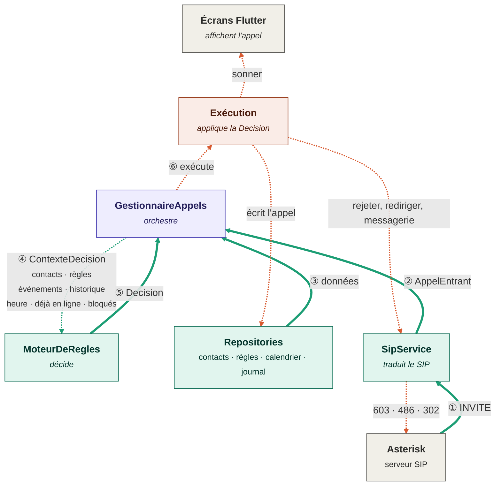
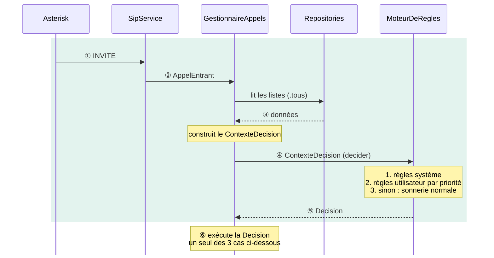
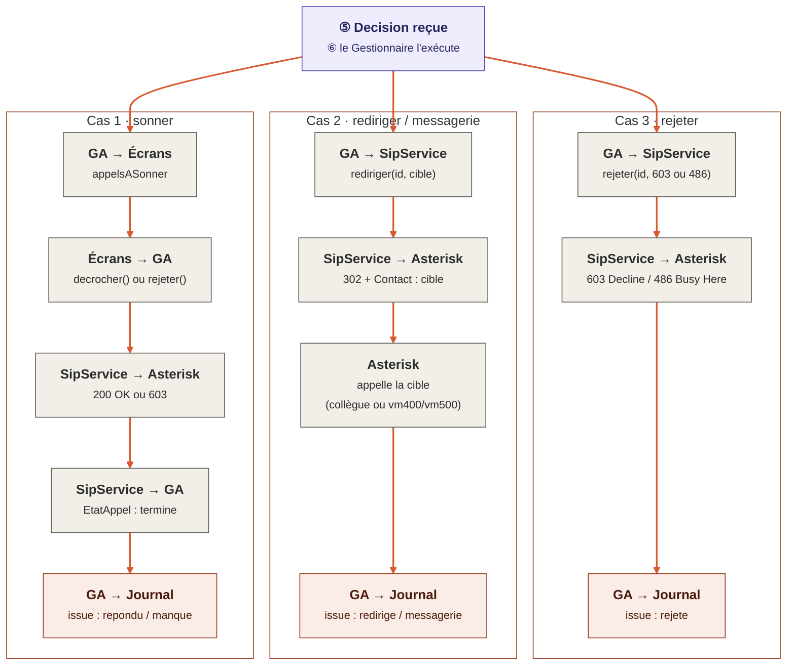

# DevWebMobile

# Gestionnaire d'appels

Application Flutter de téléphonie SIP qui **décide toute seule quoi faire d'un appel entrant** :
le faire sonner, le rejeter, le rediriger vers un collègue ou vers la messagerie,
selon **qui** appelle, **quand**, et ce qu'on a choisi de **répondre**.

**Stack** : Flutter / Dart · [sip_ua](https://github.com/flutter-webrtc/dart-sip-ua) (client SIP + WebRTC) · Asterisk (serveur SIP, dans un conteneur Podman/Docker)

**Sommaire** : [Fonctionnalités](#fonctionnalités) · [Démarrage rapide](#démarrage-rapide) · [Architecture](#architecture) · [Parcours d'un appel](#parcours-dun-appel-entrant) · [Moteur de règles](#le-moteur-de-règles) · [Structure](#structure-du-dépôt) · [Tests](#tests) · [Équipe](#travailler-en-équipe) · [Limites](#limites-connues-et-prochaines-étapes)

## Fonctionnalités

Les fonctionnalités sont rangées en trois blocs : **Qui** appelle, **Quand**, et quelle **Réponse** donner.
La colonne « Où » indique la fonction ou le fichier à ouvrir.

✅ sur `main` · 🚧 en cours (branche ouverte ou partiel) · ⏳ à faire — *état au 16/11/2026*

### Qui

| Fonctionnalité | Exemple | État | Où |
|---|---|---|---|
| Favoris | Un favori sonne toujours, même la nuit ou en réunion | ✅ | `reglesSysteme` |
| Contacts bloqués | Un contact du groupe « bloqué » part sur la messagerie | ✅ | `reglesSysteme` |
| Numéros masqués | Annonce vocale « les appels masqués ne sont pas acceptés » | ✅ | `reglesSysteme` + extension `annonce-masque` |
| Démarchage | Préfixes ARCEP (0162, 0163, 0270…) → messagerie | ✅ | `regleNumerosIndesirables` |
| Anti-harcèlement | 10 appels sans réponse en 30 min → bloqué 2 h | ✅ | `reglesSysteme` |
| Règles par appelant | « Les inconnus → messagerie », « groupe pro → collègue » | ⏳ | `appelantCorrespond` |
| Déjà en ligne | Un 2ᵉ appel pendant une communication → occupé (486) | ⏳ | `reglesSysteme` |

### Quand

| Fonctionnalité | Exemple | État | Où |
|---|---|---|---|
| En rendez-vous | Pendant un événement « occupé » → messagerie + SMS | ✅ | `calendrierCorrespond`, `regleEnRendezVous` |
| Participant au rendez-vous | L'appelant est dans la réunion en cours | ✅ | `calendrierCorrespond` |
| Jours de la semaine | « Le week-end → messagerie » | 🚧 | `jourCorrespond` (branche `feature/when-actions`) |
| Plage horaire | 18h → 9h → messagerie | 🚧 | `plageCorrespond`, `regleHorsHoraires` (branche) |
| Vacances | Un événement « vacances » dans l'agenda → messagerie | 🚧 | `vacancesCorrespond` (branche) |
| Agenda du téléphone | Lire les événements du téléphone (Android) | 🚧 | `device_calendar` (branche) |

### Réponse

| Fonctionnalité         | Exemple                                                | État                              | Où                                 |
| ---------------------- | ------------------------------------------------------ | --------------------------------- | ---------------------------------- |
| Sonner                 | L'appel s'affiche avec Décrocher / Rejeter             | ✅                                 | `GestionnaireAppels.appelsASonner` |
| Rejeter                | Réponse SIP 603 (refus) ou 486 (occupé)                | ✅                                 | `SipService.rejeter`               |
| Rediriger              | Renvoi vers un collègue (réponse 302)                  | ✅ appli · à valider avec Asterisk | `SipService.rediriger`             |
| Messagerie vocale      | Redirection (302) vers `vm` + compte (`vm400`, `vm500`) | ✅ appli · à valider avec Asterisk | `extensions.conf` (`_vm[45]XX`)    |
| SMS à l'appelant       | Message SIP (MESSAGE) envoyé à l'appelant              | ✅ appli · à valider avec Asterisk | `SipService.envoyerMessage`        |
| Message personnalisé   | « Disponible à {fin} », « Bonjour {nom} »              | ⏳                                 | `resoudreTexte`                    |
| Sonner puis renvoyer   | Sonner 20 s, puis messagerie si pas de réponse         | ✅                                 | `GestionnaireAppels` (minuteur)    |
| Appel répété = urgence | 2ᵉ appel du même numéro en 3 min → sonne               | ⏳                                 | `appelRepeteCorrespond`            |
| Journal                | Chaque appel est enregistré avec la règle qui a décidé | ✅ enregistrement · 🚧 écran       | `JournalRepository`                |

## Démarrage rapide

### Prérequis

| Outil | Version | Vérifier |
|---|---|---|
| Flutter | SDK Dart ≥ 3.13 | `flutter --version` |
| Chrome ou Chromium | récente | `flutter doctor` → ligne « Chrome » au vert |
| Docker **ou** Podman | — | `docker --version` |
| make | — | `make --version` |

> **Sous Linux avec Chromium** : Flutter cherche Chrome par défaut. Indiquez-lui Chromium avec
> `export CHROME_EXECUTABLE=/usr/bin/chromium` (à mettre dans votre `.bashrc` / `.zshrc`).
### 1. Lancer le serveur Asterisk

```bash
cd gestionnaire_appels/serveur_asterisk
make          # 1re fois : construit l'image puis lance le conteneur
make run      # les fois suivantes : lance seulement
```

Le terminal affiche ensuite la console d'Asterisk : **laissez-le ouvert** et ouvrez un
autre terminal pour la suite.

Le dossier `configuration/` est monté dans le conteneur. Après une modification de
`extensions.conf` ou de `pjsip.conf`, pas besoin de relancer : tapez `core reload`
dans la console Asterisk.

| Port | Rôle |
|---|---|
| 8088 | SIP sur WebSocket (`ws://`), **utilisé par l'appli** |
| 8089 | SIP sur WebSocket sécurisé (`wss://`) |
| 5060 | SIP classique UDP/TCP (Linphone) |
| 30000-30100 | Audio (RTP) |

### 2. Lancer l'appli

```bash
cd gestionnaire_appels
flutter pub get
flutter run -d web-server --web-port 8080
```

Ouvrez **deux onglets** sur `http://localhost:8080` : chacun jouera un téléphone.
(`flutter run -d chrome` marche aussi, avec rechargement automatique, mais sur un seul onglet.)

### 3. Premier appel

Comptes de test (le mot de passe est le numéro) :

| Compte | Type | Pour quoi |
|---|---|---|
| 400 | WebRTC | L'appli (compte prérempli) |
| 500 | WebRTC | Un 2ᵉ onglet de l'appli |
| 300 | SIP classique | Linphone ou un autre client SIP (UDP 5060) |
| 100 | Extension | Test d'écho : vous entendez votre propre voix |

1. **Onglet 1** → *Test SIP* → **Se connecter** (compte 400 déjà rempli).
2. **Onglet 2** → *Test SIP* → remplacez *Compte* et *Mot de passe* par `500` → **Se connecter**.
3. Depuis l'onglet 2, tapez `400` dans *Numéro* → **Appeler**.
4. Dans l'onglet 1, l'appel apparaît dans **« Appels reçus et décisions du moteur »** avec la décision
   *« Aucune règle : sonnerie normale »* et les boutons **Décrocher** / **Rejeter**.

**Tester une règle** : dans l'onglet 1, activez **Ne pas déranger**, puis rappelez depuis l'onglet 2.
La décision affichée devient *« Ne pas déranger »* (→ messagerie).
L'appli répond 302 vers `vm400` : l'onglet 2 entend l'annonce de la messagerie et peut laisser
un message (vérifiable dans la console Asterisk avec `voicemail show users`).

**Problème de son ?** Appelez le `100` : si vous ne vous entendez pas, le souci vient du micro
ou d'Asterisk, pas des règles. Le navigateur doit avoir l'autorisation d'utiliser le micro
(accordée automatiquement sur `localhost`).

## Architecture

L'appli est découpée en **briques qui ne connaissent chacune que leur métier** :
le SipService parle SIP sans rien décider, le MoteurDeRegles décide sans parler SIP,
et le GestionnaireAppels fait le lien entre les deux.



**Lecture** : suivre les numéros ① → ⑥.
🟩 vert = avant la décision · 🟧 orange = après la décision
Trait épais = ce que reçoit le Gestionnaire · pointillés = ce qu'il envoie

> Les lignes `~~~` sont des liens invisibles qui fixent la position des briques : ne pas les supprimer.
> Elles comptent dans la numérotation de `linkStyle` (les vraies flèches commencent à 6).

### Qui sait quoi

| Brique             | Son rôle                                                | Fichier                                 |
| ------------------ | ------------------------------------------------------- | --------------------------------------- |
| Écrans             | Affichent les appels, transmettent les clics            | `lib/screens/`                          |
| GestionnaireAppels | Fait circuler l'information, exécute la décision        | `lib/services/gestionnaire_appels.dart` |
| MoteurDeRegles     | Décide quoi faire d'un appel                            | `lib/services/moteur_regles.dart`       |
| Repositories       | Stockent contacts, règles, calendrier, journal          | `lib/repositories/repositories.dart`    |
| SipService         | Traduit le SIP en objets du projet, et inversement      | `lib/services/sip/`                     |
| Asterisk           | Route les appels, relaie la voix, héberge la messagerie | `serveur_asterisk/`                     |

Deux fichiers tiennent l'ensemble :
- **`lib/models/modeles.dart`** : le **contrat commun**, c'est-à-dire tous les objets que les briques s'échangent.
  ⚠️ Ne pas le modifier sans prévenir l'équipe.
- **`lib/services/services.dart`** : l'**assemblage**. Il crée un seul exemplaire de chaque brique et les relie.
  Pour remplacer une brique (par exemple le SipService par une version de test), c'est le seul fichier à toucher.

**Pourquoi ce découpage ?**
- Le moteur se teste avec de simples tests unitaires, sans serveur ni interface.
- On peut remplacer une brique sans toucher aux autres : le Gestionnaire ne connaît que l'interface `SipService`.
- Chacun peut travailler sur sa brique en parallèle, tant que le contrat (`modeles.dart`) ne bouge pas.
### Glossaire (noms du code)

Les numéros renvoient aux flèches du schéma.

| | Notion | Où | Ce que c'est |
|---|---|---|---|
| ① | `INVITE` | Asterisk | Le message SIP brut qui annonce un appel entrant |
| ② | `AppelEntrant` | `modeles.dart` | L'appel tel que le SipService le transmet : `idAppel`, `numero` (normalisé, ex. `"300"`), `nomAffiche`, `recuLe` |
| ③ | données | `repositories.dart` | Chaque repository expose un getter `tous` qui renvoie toute sa liste : `contacts.tous`, `regles.tous`… |
| ④ | `ContexteDecision` | `modeles.dart` | Les infos données au moteur : `contacts`, `regles`, `evenements`, `historique`, `maintenant`, `dejaEnLigne`, `bloquesJusqua` |
| ④ → ⑤ | `decider()` | `moteur_regles.dart` | Le point d'entrée unique du moteur : prend un `AppelEntrant` et un `ContexteDecision`, renvoie une `Decision` |
| ⑤ | `Decision` | `modeles.dart` | `action` (une `ActionRegle` : sonner, rejeter, rediriger, messagerie), `regle` (celle qui a gagné, ou `null`), `explication` (texte du journal) |
| ⑥ | Exécution | `GestionnaireAppels._executer()` | Pas une classe à part : une méthode du Gestionnaire, qui applique l'action et écrit dans le journal |
## Parcours d'un appel entrant

Un appel se déroule en deux temps : une **partie commune** qui aboutit à une `Decision`,
puis **un seul des trois cas** selon l'action décidée. Les numéros sont ceux du schéma d'architecture.

### Partie commune : jusqu'à la décision


La zone verte correspond à « avant la décision », comme dans le schéma d'architecture.

### Exécution : trois cas exclusifs


**GA** = GestionnaireAppels

- **Cas 1 · sonner** : c'est le seul cas où l'humain intervient. Le journal n'est écrit qu'**à la fin
  de l'appel**, car c'est seulement à ce moment qu'on sait s'il a été répondu ou manqué.
  Variante « sonner 20 s puis messagerie » : un minuteur relance le cas 2 si personne ne décroche.
- **Cas 2 · rediriger / messagerie** : l'appli ne transfère pas l'appel elle-même. Elle répond 302
  à Asterisk, qui appelle la cible à sa place. La messagerie est une redirection vers
  `vm` + le compte connecté (`vm400`, `vm500`), que le dialplan envoie sur `VoiceMail()`.
- **Cas 3 · rejeter** : 603 pour un refus, 486 pour « occupé ».

Dans tous les cas, **avant** d'exécuter l'action, le Gestionnaire peut aussi :
envoyer un SMS SIP à l'appelant (si `envoyerMessageSip` est vrai) et bloquer
temporairement le numéro (si `bloquerPendant` est renseigné).

> Les journaux sont alignés sur la même ligne exprès : les trois cas ne se suivent pas, ils s'excluent.
> Les liens allongés (`---->`, `--->`) servent à cet alignement, ne pas les raccourcir.

## Le moteur de règles

Le `MoteurDeRegles` (`lib/services/moteur_regles.dart`) est du **Dart pur** : il ne parle pas SIP
et ne lit aucune donnée lui-même. On lui donne un `AppelEntrant` et un `ContexteDecision`,
il renvoie une `Decision`. C'est ce qui le rend testable sans serveur.

### Comment il décide

`decider()` teste dans cet ordre et **s'arrête au premier résultat** :

1. **Règles système** (`reglesSysteme`) : toujours actives, non modifiables par l'utilisateur.
   | Ordre | Si… | Alors |
   |---|---|---|
   | 1 | l'appelant est un **favori** | sonne, quelles que soient les autres règles |
   | 2 | le numéro est **bloqué temporairement** | messagerie |
   | 3 | le contact est dans le groupe **bloqué** | messagerie |
   | 4 | le numéro est **masqué** | annonce vocale `annonce-masque` |
   | 5 | **trop d'appels sans réponse** (10 en 30 min) | messagerie + blocage 2 h |
   | ⏳ | l'utilisateur est **déjà en ligne** | rejet 486 (à faire) |
2. **Règles de l'utilisateur** : seulement les règles `active`, triées par `priorite` croissante.
   La **première dont la condition est vraie** gagne.
3. **Aucune règle** : `Decision.parDefaut`, le téléphone sonne.

### Anatomie d'une règle

Une `Regle` = un `nom`, une `priorite` (la plus **petite** est testée en premier),
un interrupteur `active`, une **condition** (`ConditionRegle`) et une **action** (`ActionRegle`).

**La condition** : tous les critères renseignés doivent être vrais (**ET logique**).
Un critère laissé à `null` est ignoré.

| Bloc | Critère | Exemple | Fonction |
|---|---|---|---|
| Qui | `appelant` (+ `groupe` ou `numero`) | inconnus, contacts, groupe pro, un numéro précis, masqués | `appelantCorrespond` ⏳ |
| Qui | `prefixes` | `['0162', '0163']` (démarchage) | `prefixeCorrespond` |
| Qui | `nbAppelsMin` + `nbAppelsFenetre` | 5 appels en 10 min | `seuilAppelsCorrespond` |
| Quand | `jours` | `{6, 7}` = samedi et dimanche | `jourCorrespond` 🚧 |
| Quand | `plage` | `PlageHoraire(Heure(18, 0), Heure(9, 0))` (passe minuit) | `plageCorrespond` 🚧 |
| Quand | `siCalendrierOccupe` | pendant un événement « occupé » | `calendrierCorrespond` |
| Quand | `siParticipantEvenement` | l'appelant est dans la réunion en cours | `calendrierCorrespond` |
| Quand | `siVacances` | un événement « vacances » est en cours | `vacancesCorrespond` 🚧 |
| Quand | `appelRepeteDans` | a déjà appelé il y a moins de 3 min | `appelRepeteCorrespond` ⏳ |

**L'action** : ce qu'on fait si la condition est vraie.

| Champ | Rôle |
|---|---|
| `type` | `sonner`, `rejeter`, `rediriger` ou `messagerie` |
| `cible` | numéro de redirection (ex. `"500"`) ; pour la messagerie, remplace la boîte par défaut (`vm` + compte connecté) |
| `codeSip` | code du rejet : 603 (refus, par défaut), 486 (occupé), 480 (indisponible) |
| `messageTexte` | texte envoyé à l'appelant ; variables `{fin}` (heure de fin du rendez-vous) et `{nom}` (⏳ `resoudreTexte`) |
| `envoyerMessageSip` | envoie aussi `messageTexte` par SMS SIP |
| `sonnerPendant` + `ensuite` | « sonner 20 s, puis… » (une autre `ActionRegle`) |
| `bloquerPendant` | bloque aussi le numéro pendant cette durée |

**Exemple** : « les inconnus, le week-end, vont sur la messagerie avec un SMS »

```dart
const regle = Regle(
  id: 'inconnus-weekend',
  nom: 'Inconnus le week-end',
  priorite: 10,
  condition: ConditionRegle(
    appelant: TypeAppelant.inconnus,
    jours: {DateTime.saturday, DateTime.sunday},
  ),
  action: ActionRegle(
    type: TypeAction.messagerie,
    envoyerMessageSip: true,
    messageTexte: 'Je vous rappelle lundi.',
  ),
);
await Services.regles.enregistrer(regle);
```

### Règles prêtes à l'emploi

| Règle | Priorité | Effet | Où |
|---|---|---|---|
| `regleNumerosIndesirables()` | 0 | Préfixes de démarchage ARCEP → messagerie | `main`, chargée par défaut |
| `regleVacances` | 3 | En vacances → messagerie + SMS | branche `feature/when-actions` |
| `regleEnRendezVous` | 5 | En rendez-vous → messagerie + SMS « disponible à {fin} » | `main` |
| `regleHorsHoraires()` | 20 | 18h → 9h → messagerie + SMS | branche `feature/when-actions` |
| Ne pas déranger | 100 | Tout → messagerie (interrupteur de l'écran Test SIP) | `sip_test_screen.dart` |

### Réglages du moteur

Le constructeur de `MoteurDeRegles` permet d'ajuster l'anti-harcèlement :
`seuilHarcelement` (10), `fenetreHarcelement` (30 min), `dureeBlocageHarcelement` (2 h).
⚠️ Dans `services.dart`, le seuil est **abaissé à 3** pour les tests : le remettre à 10 pour la version finale.

### Ajouter un nouveau critère

1. Ajouter le champ dans `ConditionRegle` (`modeles.dart`). ⚠️ **Prévenir l'équipe**, c'est le contrat commun.
2. Écrire la fonction `xxxCorrespond` dans `moteur_regles.dart`, en respectant la convention :
   **champ `null` ou non utilisé → `true`** (le critère ne filtre rien), sinon `true` seulement si le critère est rempli.
3. L'ajouter au ET logique de `conditionVerifiee`.
4. Écrire au moins un test dans `test/moteur_regles_test.dart`.

## Structure du dépôt

```
DevWebMobile/
├── README.md                       ← ce fichier
└── gestionnaire_appels/            ← le projet Flutter
    ├── pubspec.yaml                ← dépendances (sip_ua, flutter_webrtc)
    ├── lib/
    │   ├── main.dart               ← point d'entrée : démarre le Gestionnaire puis l'interface
    │   ├── models/
    │   │   ├── modeles.dart        ← ⚠️ contrat commun : tous les objets échangés
    │   │   └── appel.dart          ← ancien modèle, utilisé par l'écran Journal (à remplacer)
    │   ├── services/
    │   │   ├── services.dart       ← assemblage : crée et relie toutes les briques
    │   │   ├── gestionnaire_appels.dart
    │   │   ├── moteur_regles.dart
    │   │   └── sip/
    │   │       ├── sip_service.dart     ← interface (le contrat du SipService)
    │   │       └── sip_service_ua.dart  ← implémentation réelle avec sip_ua
    │   ├── repositories/
    │   │   └── repositories.dart   ← interfaces + versions en mémoire
    │   ├── screens/                ← un fichier par onglet
    │   │   ├── accueil_screen.dart ← barre de navigation
    │   │   ├── journal_screen.dart
    │   │   ├── contacts_screen.dart
    │   │   ├── clavier_screen.dart
    │   │   └── sip_test_screen.dart ← connexion, appels et décisions en direct
    │   ├── widgets/                ← composants réutilisés par les écrans
    │   └── data/
    │       └── fausses_donnees.dart ← données de démo (à supprimer à terme)
    ├── test/
    │   └── moteur_regles_test.dart ← tests unitaires du moteur
    └── serveur_asterisk/
        ├── Makefile                ← make / make run
        ├── Dockerfile
        └── configuration/          ← monté dans le conteneur
            ├── pjsip.conf          ← comptes 300, 400, 500 et transports
            ├── extensions.conf     ← dialplan : _XXX, 100 (écho), vm400/vm500, annonce-masque
            └── http.conf           ← WebSocket 8088 / 8089
```

| Brique du schéma | Fichier |
|---|---|
| Écrans | `lib/screens/` |
| GestionnaireAppels (+ Exécution) | `lib/services/gestionnaire_appels.dart` |
| MoteurDeRegles | `lib/services/moteur_regles.dart` |
| Repositories | `lib/repositories/repositories.dart` |
| SipService | `lib/services/sip/` |
| Asterisk | `serveur_asterisk/` |

## Tests

```bash
cd gestionnaire_appels
flutter test
```

Les tests du moteur n'ont besoin ni d'Asterisk ni d'interface : on construit un `ContexteDecision`
à la main, on appelle `decider()` et on vérifie la `Decision`.

```dart
test('nuit → messagerie à 23h', () {
  final d = moteur.decider(
    appelDe('300'),
    ContexteDecision(maintenant: DateTime(2026, 11, 12, 23, 0), regles: [nuit]),
  );
  expect(d.action.type, TypeAction.messagerie);
});
```

- **`maintenant` est choisi par le test** : c'est ce qui permet de simuler « dimanche à 23h »
  sans attendre dimanche. Le `GestionnaireAppels` accepte de la même façon une `horloge`.
- **Convention `skip`** : un test écrit avant son implémentation est marqué
  `skip: 'nomDeLaFonction'`. Une fois la fonction faite, on **enlève le `skip`** et le test doit passer.
- Avant chaque PR : `flutter test` doit être vert (hors `skip`).

## Travailler en équipe

### Répartition

| Bloc | Responsable | Fonctions | Branche |
|---|---|---|---|
| Qui | Mattis | `reglesSysteme`, `appelantCorrespond`, `prefixeCorrespond`, `seuilAppelsCorrespond` | `feature/who-actions` |
| Quand | Noussayba, Dimitri | `jourCorrespond`, `plageCorrespond`, `calendrierCorrespond`, `vacancesCorrespond`, agenda du téléphone | `feature/when-actions` |
| Réponse | Mathieu | `resoudreTexte`, `_executer`, `SipService.rejeter/rediriger/envoyerMessage`, messagerie `vm400` côté Asterisk | `feature/response-actions` |
| À attribuer | — | `appelRepeteCorrespond`, écran Journal, écrans Règles et Calendrier | — |

### Workflow Git

1. Partir de `main` à jour : `git switch main && git pull`.
2. Travailler sur la branche de son bloc : `git switch -c feature/...`.
3. Avant la PR : `git merge main`, puis `flutter test`.
4. Ouvrir une **Pull Request vers `main`** sur GitHub ; un autre membre relit avant le merge.

### Règles d'or

- ⚠️ **Ne pas modifier `lib/models/modeles.dart` sans prévenir** : tout le monde en dépend.
- **Un bloc = une branche = ses propres fonctions** dans `moteur_regles.dart`, pour éviter les conflits.
- **Les écrans passent toujours par `Services.gestionnaire`**, jamais directement par sip_ua.
- Mettre à jour les états ✅ 🚧 ⏳ de ce README quand une fonctionnalité est mergée.

## Limites connues et prochaines étapes

| Limite | Conséquence | Piste |
|---|---|---|
| Données en mémoire | Contacts, règles et journal sont perdus à chaque redémarrage | Repositories persistants (`sqflite` sur Android), en gardant la version mémoire pour le web |
| Dial de 10 s dans `_[45]XX` | Asterisk envoie lui-même sur la messagerie au bout de 10 s : la règle « sonner 20 s puis messagerie » de l'appli ne se déclenche jamais | Allonger le `Dial` (> 20 s) ou raccourcir `sonnerPendant` |
| Redirection 302 et SMS SIP non validés | On ne sait pas encore si Asterisk suit le 302 et relaie les MESSAGE | Tester avec deux clients ; vérifier `res_pjsip_messaging` |
| Écran Journal sur fausses données | Le vrai journal n'est pas affiché | Brancher l'écran sur `Services.journal.surveiller()` |
| Pas d'écran Règles ni Calendrier | Les règles s'ajoutent seulement dans le code (ou « Ne pas déranger ») | Écrans de création / édition |
| Seuil anti-harcèlement à 3 | Valeur de test dans `services.dart` | Remettre 10 avant le rendu |
| Arrière-plan Android | Android peut couper le WebSocket SIP quand l'appli est en veille | Service au premier plan (`flutter_foreground_task`) + notification d'appel |
| Pas de `SipServiceFaux` | Impossible de tester l'interface sans Asterisk | Implémenter l'interface `SipService` avec des appels simulés |

## Équipe

| Membre | Rôle |
|---|---|
| Mattis | Architecture commune, serveur Asterisk, bloc Qui |
| Noussayba | Bloc Quand (agenda, vacances, horaires) |
| Dimitri | Bloc Quand, documentation |
| Mathieu | Bloc Réponse |

Projet de groupe — ENSEIRB-MATMECA, 3ᵉ année.