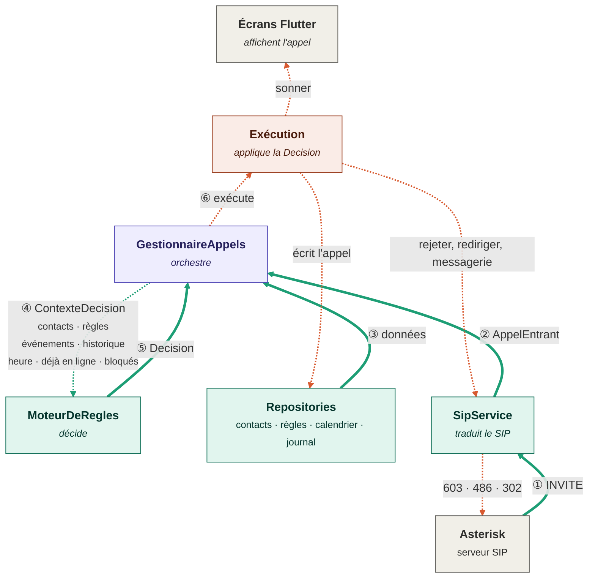
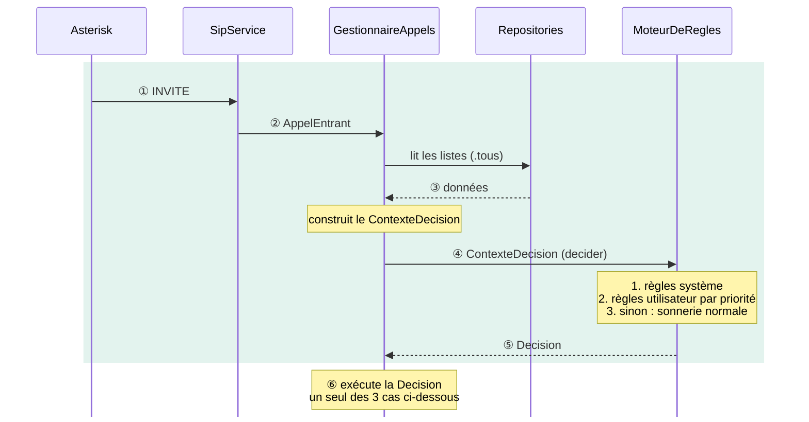
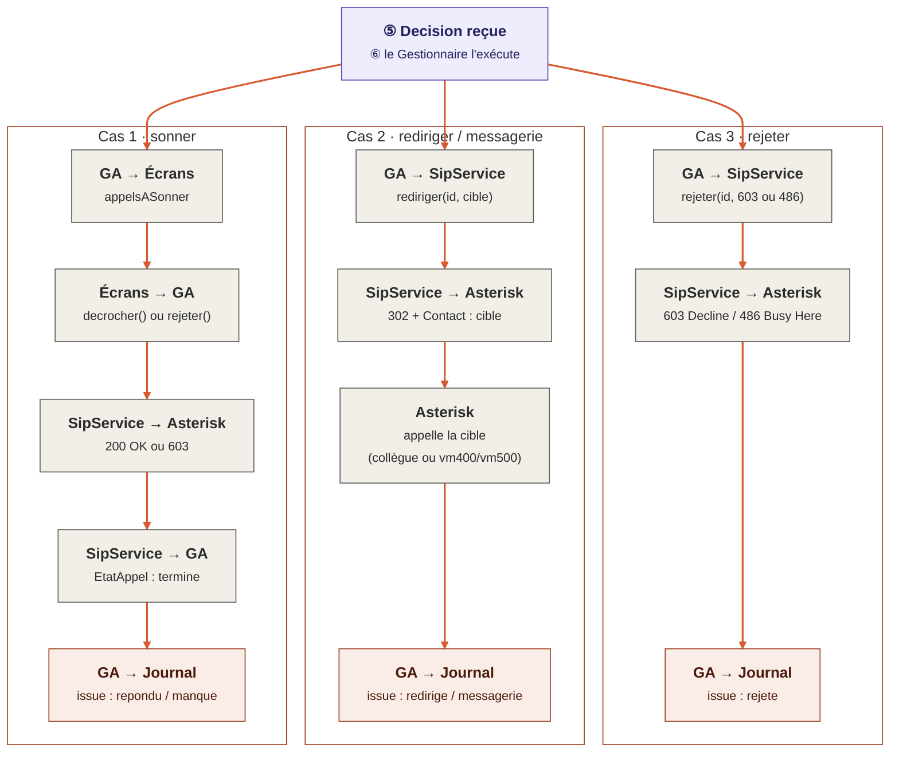

# Gestionnaire d'appels

Application Flutter de téléphonie SIP qui **décide toute seule quoi faire d'un appel entrant** :
le faire sonner, le rejeter, le renvoyer vers un collègue ou la messagerie vocale, envoyer un message
à l'appelant… selon **qui** appelle, **quand**, et ce qu'on a choisi de **répondre**.

**Stack** : Flutter / Dart · [sip_ua](https://github.com/flutter-webrtc/dart-sip-ua) (SIP + WebRTC) · Asterisk 16 (conteneur Docker)
**Présentation** : mercredi 16 décembre 2026

**Sommaire** : [État](#état-du-projet) · [Démarrage rapide](#démarrage-rapide) · [Android](#lancer-sur-android) · [Reste à faire](#reste-à-faire--cibler-la-démo) · [Architecture](#architecture) · [Parcours d'un appel](#parcours-dun-appel-entrant) · [Moteur de règles](#le-moteur-de-règles) · [Structure](#structure-du-dépôt) · [Tests](#tests) · [Équipe](#travailler-en-équipe)

## État du projet

*Au 19/11/2026* · ✅ sur `main` · 🚧 partiel · ⏳ à faire

**Testé de bout en bout** (appli + Asterisk, deux onglets) : appel et décision du moteur, journal,
messagerie vocale, message rapide reçu par l'appelant, annonce pour les numéros masqués.

### Qui appelle

| Fonctionnalité      | Exemple                                                  | État                       | Où                                           |
| ------------------- | -------------------------------------------------------- | -------------------------- | -------------------------------------------- |
| Favoris             | Un favori sonne toujours, même en « Ne pas déranger »    | ✅                          | `reglesSysteme`                              |
| Contacts bloqués    | Groupe « Bloqué » → messagerie                           | ✅                          | `reglesSysteme`                              |
| Numéros masqués     | Annonce « les appels masqués ne sont pas acceptés »      | ✅                          | `reglesSysteme` + extension `annonce-masque` |
| Démarchage          | Préfixes ARCEP (0162, 0163, 0270…) → messagerie          | ✅                          | `regleNumerosIndesirables`                   |
| Anti-harcèlement    | Trop d'appels sans réponse en 30 min → bloqué 2 h        | ✅ seuil à 3 pour les tests | `reglesSysteme`                              |
| Règles par appelant | « Les inconnus → messagerie », « groupe pro → collègue » | ✅                          | `appelantCorrespond`                         |
| Déjà en ligne       | 2ᵉ appel pendant une communication → occupé (486)        | ⏳                          | `reglesSysteme`                              |

### Quand

| Fonctionnalité             | Exemple                                                                         | État                                             | Où                                          |
| -------------------------- | ------------------------------------------------------------------------------- | ------------------------------------------------ | ------------------------------------------- |
| En rendez-vous             | Événement en cours → messagerie + SMS « disponible à {fin} »                    | ✅ moteur · ⏳ aucun écran pour créer un événement | `calendrierCorrespond`, `regleEnRendezVous` |
| Participant au rendez-vous | L'appelant est dans la réunion en cours                                         | ✅ moteur                                         | `calendrierCorrespond`                      |
| Jours de la semaine        | « Le week-end → messagerie »                                                    | ✅                                                | `jourCorrespond`                            |
| Plage horaire              | 18h → 9h → messagerie + SMS                                                     | ✅                                                | `plageCorrespond`, `regleHorsHoraires`      |
| Vacances                   | Événement « vacances » / « congé » → messagerie + SMS « de retour le {retour} » | ✅                                                | `vacancesCorrespond`, `regleVacances`       |
| Agenda du téléphone        | Lire le calendrier Android                                                      | ⏳ `device_calendar` déclaré, pas utilisé         | —                                           |

### Réponse

| Fonctionnalité | Exemple | État | Où |
|---|---|---|---|
| Sonner | Écran plein avec Décrocher / Raccrocher | ✅ | `AppelEntrantScreen`, `EtatAppels` |
| Rejeter | Réponse SIP 603 (refus) ou 486 (occupé) | ✅ | `SipService.rejeter` |
| Message rapide | Bouton sur l'écran d'appel : message à l'appelant + rejet 486 | ✅ | `EtatAppels.refuserAvecMessage` |
| SMS automatique | Une règle envoie un message à l'appelant (`envoyerMessageSip`) | ✅ | `GestionnaireAppels`, contexte `[messages]` |
| Messages reçus | Onglet Messages, pastille et bandeau | ✅ | `SipServiceUa.onNewMessage`, `MessagesScreen` |
| Messagerie vocale | 302 vers `vm` + compte connecté → `VoiceMail()` | ✅ | `extensions.conf` (`_vm[45]XX`) |
| Message personnalisé | Variables `{fin}`, `{nom}`, `{retour}` | ✅ | `resoudreTexte` |
| Rediriger vers un collègue | 302 vers un autre numéro | ✅ appli · ⏳ jamais testé avec Asterisk | `SipService.rediriger` |
| Sonner puis renvoyer | Sonner 20 s, puis messagerie | ⚠️ court-circuité par le `Dial` de 10 s d'Asterisk | `GestionnaireAppels` (minuteur) |
| Appel répété = urgence | 2ᵉ appel du même numéro en 3 min → sonne | ⏳ | `appelRepeteCorrespond` |

### Interface

✅ Journal (vrais appels + règle qui a décidé) · ✅ Messages · ✅ Contacts et groupes · ✅ Paramètres
(Ne pas déranger, compte SIP) · ✅ Clavier · ⏳ écran Règles · ⏳ écran Agenda ·
⏳ **jamais lancé sur Android** (tout est testé dans Chrome)

## Démarrage rapide

### Prérequis

| Outil | Vérifier |
|---|---|
| Flutter (SDK Dart ≥ 3.13) | `flutter --version` |
| Chrome ou Chromium | `flutter doctor` → ligne « Chrome » au vert |
| Docker (ou Podman avec la commande `docker`) | `docker --version` |
| make | `make --version` |

> **Linux avec Chromium** : `export CHROME_EXECUTABLE=/usr/bin/chromium` dans votre `.bashrc` / `.zshrc`.

### Lancer

```bash
cd gestionnaire_appels
./lancer.sh          # Asterisk + sa console dans une 2e fenêtre + appli sur http://localhost:8080
./lancer.sh chrome   # variante : un seul onglet Chrome, avec rechargement à chaud
```

La 1ʳᵉ fois, le script construit l'image Asterisk. **Ctrl+C** arrête l'appli **et** Asterisk.
Sans le script : `make` (puis `make run`) dans `serveur_asterisk/`, et
`flutter run -d web-server --web-port 8080` dans `gestionnaire_appels/`.

**Console Asterisk** : `docker exec -it asterisk asterisk -r`

| Après avoir modifié… | Taper |
|---|---|
| `extensions.conf`, `pjsip.conf` | `core reload` |
| `voicemail.conf` | `voicemail reload` |
| `modules.conf` | redémarrer le conteneur |

Commandes utiles : `voicemail show users` (messages déposés), `pjsip show contacts` (qui est connecté),
`pjsip set logger on` (voir passer le SIP).

### Comptes et numéros de test

| Numéro | Rôle |
|---|---|
| 400 | L'appli (connexion automatique au démarrage, mot de passe `400`) |
| 500 | 2ᵉ onglet de l'appli (mot de passe `500`) |
| 300 | Linphone ou autre client SIP classique (UDP 5060) |
| 100 | Test d'écho : on entend sa propre voix |
| 8400 | Appelle le 400 en **numéro masqué** |
| 9400 | Appelle le 400 depuis un numéro de **démarchage** (0162…) |
| \*77 | Enregistrer l'annonce des numéros masqués |
| vm400, vm500 | Messageries vocales (cibles des 302 envoyés par l'appli) |

Ports : **8080** appli web · **8088** SIP sur WebSocket (utilisé par l'appli) · 8089 WebSocket sécurisé ·
5060 SIP classique · 30000-30100 audio (RTP).

### Premier appel

1. Ouvrir **deux onglets** sur `http://localhost:8080` : chacun est un téléphone indépendant.
   Les deux démarrent connectés en 400.
2. **Onglet 2** → bouton rond en haut à droite (ou *Paramètres* → *Serveur SIP*) → compte `500`, mot de passe `500`.
3. **Onglet 2** → *Journal* → bouton Clavier → composer `400` → appeler.
4. **Onglet 1** : l'écran d'appel entrant s'affiche. Après l'appel, le *Journal* indique la règle qui a décidé.

**Problème de son ?** Composer `100` : sans écho, le souci vient du micro ou d'Asterisk, pas des règles.
Les deux onglets partagent le même micro : prévoir un casque.

### Scénarios de test

Toujours : **onglet 1 = 400** (celui qui reçoit), **onglet 2 = 500** (celui qui appelle).

| Pour tester | Faire | Résultat attendu |
|---|---|---|
| Messagerie vocale | Onglet 1 : *Paramètres* → *Ne pas déranger*. Onglet 2 appelle 400 | Annonce de messagerie, message déposé (`voicemail show users`) |
| Favori | Onglet 1 : ajouter 500 dans *Contacts*, groupe *Favori*, garder *Ne pas déranger* | Ça sonne quand même |
| Bloqué | Onglet 1 : passer le contact 500 dans le groupe *Bloqué* | Messagerie |
| Message rapide | Onglet 2 appelle 400. Onglet 1 : *Message rapide* → choisir un texte | Appel rejeté ; bandeau et onglet *Messages* dans l'onglet 2 |
| Numéro masqué | Onglet 2 compose `8400` (enregistrer l'annonce avant avec `*77`) | Annonce « appels masqués non acceptés » |
| Démarchage | Onglet 2 compose `9400` | Messagerie |
| Anti-harcèlement | Onglet 2 appelle 400 plusieurs fois sans qu'on décroche | Au 4ᵉ appel (seuil 3 dépassé) : messagerie + numéro bloqué 2 h |

### Lancer sur Android

⏳ **Jamais testé** : la cible du projet est le téléphone, mais tout a été développé dans Chrome.
Voici ce qu'il faudra faire (à mettre à jour après le premier essai).

**1. Un appareil** : un émulateur (Android Studio → *Device Manager*) ou un vrai téléphone en
mode développeur. Vérifier avec `flutter devices`, puis :

```bash
./lancer.sh                       # Asterisk (l'appli web peut rester ouverte en parallèle)
flutter run -d <id-de-l-appareil> # dans un 2e terminal, depuis gestionnaire_appels/
```

**2. L'adresse du serveur** : `127.0.0.1` désigne le téléphone lui-même, pas le PC.
Au démarrage, changer l'IP dans *Paramètres* → *Serveur SIP* :

| Appareil | IP du serveur |
|---|---|
| Émulateur Android | `10.0.2.2` (alias du PC hôte) |
| Vrai téléphone | IP du PC sur le même réseau (`ip a`). eduroam isole les appareils entre eux : passer par le partage de connexion du téléphone |

**3. Le manifeste** (`android/app/src/main/AndroidManifest.xml`) ne déclare aujourd'hui que
`READ_CONTACTS` et `READ_CALENDAR`. Il manque très probablement :

```xml
<uses-permission android:name="android.permission.INTERNET"/>
<uses-permission android:name="android.permission.RECORD_AUDIO"/>
<uses-permission android:name="android.permission.MODIFY_AUDIO_SETTINGS"/>
<uses-permission android:name="android.permission.ACCESS_NETWORK_STATE"/>
```

et, si la connexion `ws://` (non chiffrée) est refusée, `android:usesCleartextTraffic="true"`
sur la balise `<application>`.

**4. Le micro de l'émulateur** est coupé par défaut : *Extended controls* (`…`) → *Microphone* →
activer *Virtual microphone uses host audio input*.

**Points à vérifier au premier essai** : la connexion SIP (indicateur dans *Paramètres*), un appel
vers le `100` (écho : micro et audio RTP à travers le NAT de l'émulateur), l'écran d'appel entrant,
puis un appel entre l'émulateur (400) et un onglet Chrome (500).

## Reste à faire : cibler la démo

**Principe** : la démo du 16/12 montre 6 ou 7 appels, chacun illustrant une règle de bout en bout.
Ce qui ne sert pas ce scénario passe après. On **gèle les fonctionnalités à l'avant-dernière séance** ;
la dernière sert à répéter et à enregistrer une **vidéo de secours** de la démo.

### Scénario de démo (proposition)

| # | Appel | Montre | Prêt ? |
|---|---|---|---|
| 1 | Un inconnu appelle, on décroche | L'appel, le journal | ✅ |
| 2 | Même appel pendant un rendez-vous | Messagerie + SMS « disponible à 15:30 » reçu par l'appelant | 🚧 écran Agenda |
| 3 | Un favori appelle en « Ne pas déranger » | La priorité des règles système | ✅ |
| 4 | Démarchage (`9400`) puis numéro masqué (`8400`) | Le filtrage | ✅ |
| 5 | On refuse avec un message rapide | Le message lu chez l'appelant | ✅ |
| 6 | Le même numéro insiste (4 appels sans réponse) | L'anti-harcèlement | ✅ |
| 7 | (option) Appel à 19h | La plage horaire | 🚧 simuler l'heure |

### P0 : bloquant pour la démo

| Tâche                                                                         | Pourquoi                                                             | Où                    |
| ----------------------------------------------------------------------------- | -------------------------------------------------------------------- | --------------------- |
| Écran Agenda (ou bouton « données de démo » qui crée un rendez-vous en cours) | Sinon rendez-vous et vacances ne se montrent qu'en modifiant le code | `Services.calendrier` |
| Tester la redirection vers un collègue (302 → 500)                            | Jamais vérifiée avec Asterisk                                        | —                     |
| Lancer une fois sur Android (émulateur) | La cible est le téléphone ; tout n'a été testé que dans Chrome | [Lancer sur Android](#lancer-sur-android) |

### P1 : rend la démo plus convaincante

| Tâche | Pourquoi | Où |
|---|---|---|
| Écran Règles (lister, activer, créer) | Créer une règle en direct pendant la démo | `Services.regles` |
| Simuler l'heure (mode démo) | Montrer « hors horaires » en pleine journée | `GestionnaireAppels` accepte déjà une `horloge` |
| Choisir qui décide après 10 s | Le `Dial(…,10)` d'Asterisk envoie sur la messagerie avant la règle « sonner 20 s » de l'appli | `extensions.conf` (`_[45]XX`) |
| Seuil anti-harcèlement : 3 pour la démo ou 10 ? | Décider et l'écrire | `services.dart` |

### P2 : si le temps le permet

`appelRepeteCorrespond` · « déjà en ligne » · nettoyage du code plus utilisé (`sip_test_screen.dart`,
`fausses_donnees.dart`, `models/appel.dart`, `tuile_appel.dart` : vérifier avant de supprimer) et des
dépendances inutilisées (`flutter_contacts`, `device_calendar`) · fusionner `README_MESSAGES.md` ici.

### Hors périmètre (à présenter comme limites)

Vidéo · persistance (contacts, règles et journal sont **en mémoire**, perdus au redémarrage ; les
messages vocaux sont dans le conteneur) · appli en arrière-plan sur Android · agenda du téléphone ·
plusieurs appareils réels (tout tourne en `localhost`).

## Architecture

L'appli est découpée en **briques qui ne connaissent chacune que leur métier** :
le SipService parle SIP sans rien décider, le MoteurDeRegles décide sans parler SIP,
et le GestionnaireAppels fait le lien entre les deux.



**Lecture** : suivre les numéros ① → ⑥.
🟩 vert = avant la décision · 🟧 orange = après la décision
Trait épais = ce que reçoit le Gestionnaire · pointillés = ce qu'il envoie

> Les lignes `~~~` sont des liens invisibles qui fixent la position des briques : ne pas les supprimer.
> Elles comptent dans la numérotation de `linkStyle` (les vraies flèches commencent à 6).

### Qui sait quoi

| Brique             | Son rôle                                                | Fichier                                 |
| ------------------ | ------------------------------------------------------- | --------------------------------------- |
| Écrans             | Affichent les appels, transmettent les clics            | `lib/screens/`                          |
| EtatAppels         | Ce que l'interface affiche : appel qui sonne, en cours, connexion | `lib/services/etat_appels.dart` |
| GestionnaireAppels | Fait circuler l'information, exécute la décision        | `lib/services/gestionnaire_appels.dart` |
| MoteurDeRegles     | Décide quoi faire d'un appel                            | `lib/services/moteur_regles.dart`       |
| Repositories       | Stockent contacts, règles, calendrier, journal, messages | `lib/repositories/repositories.dart`    |
| SipService         | Traduit le SIP en objets du projet, et inversement      | `lib/services/sip/`                     |
| Asterisk           | Route les appels, relaie la voix et les messages, héberge la messagerie vocale | `serveur_asterisk/`                     |

Deux fichiers tiennent l'ensemble :
- **`lib/models/modeles.dart`** : le **contrat commun**, c'est-à-dire tous les objets que les briques s'échangent.
  ⚠️ Ne pas le modifier sans prévenir l'équipe.
- **`lib/services/services.dart`** : l'**assemblage**. Il crée un seul exemplaire de chaque brique et les relie.
  Pour remplacer une brique (par exemple le SipService par une version de test), c'est le seul fichier à toucher.

**Pourquoi ce découpage ?**
- Le moteur se teste avec de simples tests unitaires, sans serveur ni interface.
- On peut remplacer une brique sans toucher aux autres : le Gestionnaire ne connaît que l'interface `SipService`.
- Chacun peut travailler sur sa brique en parallèle, tant que le contrat (`modeles.dart`) ne bouge pas.
### Glossaire (noms du code)

Les numéros renvoient aux flèches du schéma.

| | Notion | Où | Ce que c'est |
|---|---|---|---|
| ① | `INVITE` | Asterisk | Le message SIP brut qui annonce un appel entrant |
| ② | `AppelEntrant` | `modeles.dart` | L'appel tel que le SipService le transmet : `idAppel`, `numero` (normalisé, ex. `"300"`), `nomAffiche`, `recuLe` |
| ③ | données | `repositories.dart` | Chaque repository expose un getter `tous` qui renvoie toute sa liste : `contacts.tous`, `regles.tous`… |
| ④ | `ContexteDecision` | `modeles.dart` | Les infos données au moteur : `contacts`, `regles`, `evenements`, `historique`, `maintenant`, `dejaEnLigne`, `bloquesJusqua` |
| ④ → ⑤ | `decider()` | `moteur_regles.dart` | Le point d'entrée unique du moteur : prend un `AppelEntrant` et un `ContexteDecision`, renvoie une `Decision` |
| ⑤ | `Decision` | `modeles.dart` | `action` (une `ActionRegle` : sonner, rejeter, rediriger, messagerie), `regle` (celle qui a gagné, ou `null`), `explication` (texte du journal) |
| ⑥ | Exécution | `GestionnaireAppels._executer()` | Pas une classe à part : une méthode du Gestionnaire, qui applique l'action et écrit dans le journal |
## Parcours d'un appel entrant

Un appel se déroule en deux temps : une **partie commune** qui aboutit à une `Decision`,
puis **un seul des trois cas** selon l'action décidée. Les numéros sont ceux du schéma d'architecture.

### Partie commune : jusqu'à la décision


La zone verte correspond à « avant la décision », comme dans le schéma d'architecture.

### Exécution : trois cas exclusifs


**GA** = GestionnaireAppels

- **Cas 1 · sonner** : c'est le seul cas où l'humain intervient. Le journal n'est écrit qu'**à la fin
  de l'appel**, car c'est seulement à ce moment qu'on sait s'il a été répondu ou manqué.
  Variante « sonner 20 s puis messagerie » : un minuteur relance le cas 2 si personne ne décroche.
- **Cas 2 · rediriger / messagerie** : l'appli ne transfère pas l'appel elle-même. Elle répond 302
  à Asterisk, qui appelle la cible à sa place. La messagerie est une redirection vers
  `vm` + le compte connecté (`vm400`, `vm500`), que le dialplan envoie sur `VoiceMail()`.
  ⚠️ Asterisk bascule aussi **lui-même** sur la messagerie si personne ne décroche en 10 s (`Dial(…,10)` dans `_[45]XX`).
- **Cas 3 · rejeter** : 603 pour un refus, 486 pour « occupé ».

Dans tous les cas, **avant** d'exécuter l'action, le Gestionnaire peut aussi :
envoyer un SMS SIP à l'appelant (si `envoyerMessageSip` est vrai) et bloquer
temporairement le numéro (si `bloquerPendant` est renseigné).

> Les journaux sont alignés sur la même ligne exprès : les trois cas ne se suivent pas, ils s'excluent.
> Les liens allongés (`---->`, `--->`) servent à cet alignement, ne pas les raccourcir.

## Le moteur de règles

Le `MoteurDeRegles` (`lib/services/moteur_regles.dart`) est du **Dart pur** : il ne parle pas SIP
et ne lit aucune donnée lui-même. On lui donne un `AppelEntrant` et un `ContexteDecision`,
il renvoie une `Decision`. C'est ce qui le rend testable sans serveur.

### Comment il décide

`decider()` teste dans cet ordre et **s'arrête au premier résultat** :

1. **Règles système** (`reglesSysteme`) : toujours actives, non modifiables par l'utilisateur.
   | Ordre | Si… | Alors |
   |---|---|---|
   | 1 | l'appelant est un **favori** | sonne, quelles que soient les autres règles |
   | 2 | le numéro est **bloqué temporairement** | messagerie |
   | 3 | le contact est dans le groupe **bloqué** | messagerie |
   | 4 | le numéro est **masqué** | annonce vocale `annonce-masque` |
   | 5 | **plus de 10 appels sans réponse** en 30 min (3 pour les tests) | messagerie + blocage 2 h |
   | ⏳ | l'utilisateur est **déjà en ligne** | rejet 486 (à faire) |
2. **Règles de l'utilisateur** : seulement les règles `active`, triées par `priorite` croissante.
   La **première dont la condition est vraie** gagne.
3. **Aucune règle** : `Decision.parDefaut`, le téléphone sonne.

### Anatomie d'une règle

Une `Regle` = un `nom`, une `priorite` (la plus **petite** est testée en premier),
un interrupteur `active`, une **condition** (`ConditionRegle`) et une **action** (`ActionRegle`).

**La condition** : tous les critères renseignés doivent être vrais (**ET logique**).
Un critère laissé à `null` est ignoré.

| Bloc | Critère | Exemple | Fonction |
|---|---|---|---|
| Qui | `appelant` (+ `groupe` ou `numero`) | inconnus, contacts, groupe pro, un numéro précis, masqués | `appelantCorrespond` |
| Qui | `prefixes` | `['0162', '0163']` (démarchage) | `prefixeCorrespond` |
| Qui | `nbAppelsMin` + `nbAppelsFenetre` | 5 appels en 10 min | `seuilAppelsCorrespond` |
| Quand | `jours` | `{6, 7}` = samedi et dimanche | `jourCorrespond` |
| Quand | `plage` | `PlageHoraire(Heure(18, 0), Heure(9, 0))` (passe minuit) | `plageCorrespond` |
| Quand | `siCalendrierOccupe` | pendant un événement « occupé » | `calendrierCorrespond` |
| Quand | `siParticipantEvenement` | l'appelant est dans la réunion en cours | `calendrierCorrespond` |
| Quand | `siVacances` | un événement « vacances » est en cours | `vacancesCorrespond` |
| Quand | `appelRepeteDans` | a déjà appelé il y a moins de 3 min | `appelRepeteCorrespond` ⏳ |

**L'action** : ce qu'on fait si la condition est vraie.

| Champ | Rôle |
|---|---|
| `type` | `sonner`, `rejeter`, `rediriger` ou `messagerie` |
| `cible` | numéro de redirection (ex. `"500"`) ; pour la messagerie, remplace la boîte par défaut (`vm` + compte connecté) |
| `codeSip` | code du rejet : 603 (refus, par défaut), 486 (occupé), 480 (indisponible) |
| `messageTexte` | texte envoyé à l'appelant ; variables `{fin}` (fin du rendez-vous), `{nom}` (nom du contact), `{retour}` (retour de vacances) |
| `envoyerMessageSip` | envoie aussi `messageTexte` par SMS SIP |
| `sonnerPendant` + `ensuite` | « sonner 20 s, puis… » (une autre `ActionRegle`) |
| `bloquerPendant` | bloque aussi le numéro pendant cette durée |

**Exemple** : « les inconnus, le week-end, vont sur la messagerie avec un SMS »

```dart
const regle = Regle(
  id: 'inconnus-weekend',
  nom: 'Inconnus le week-end',
  priorite: 10,
  condition: ConditionRegle(
    appelant: TypeAppelant.inconnus,
    jours: {DateTime.saturday, DateTime.sunday},
  ),
  action: ActionRegle(
    type: TypeAction.messagerie,
    envoyerMessageSip: true,
    messageTexte: 'Je vous rappelle lundi.',
  ),
);
await Services.regles.enregistrer(regle);
```

### Règles prêtes à l'emploi

Toutes sont **chargées par défaut** dans `services.dart` (sauf Ne pas déranger, qui est un interrupteur).

| Règle | Priorité | Effet |
|---|---|---|
| `regleNumerosIndesirables()` | 0 | Préfixes de démarchage ARCEP → messagerie |
| `regleVacances` | 3 | Événement « vacances » en cours → messagerie + SMS « de retour le {retour} » |
| `regleEnRendezVous` | 5 | Événement en cours → messagerie + SMS « disponible à {fin} » |
| `regleHorsHoraires()` | 20 | 18h → 9h → messagerie + SMS |
| Ne pas déranger | 100 | Tout → messagerie (*Paramètres*, `Services.definirNePasDeranger`) |

### Réglages du moteur

Le constructeur de `MoteurDeRegles` permet d'ajuster l'anti-harcèlement :
`seuilHarcelement` (10), `fenetreHarcelement` (30 min), `dureeBlocageHarcelement` (2 h).
⚠️ Dans `services.dart`, le seuil est **abaissé à 3** pour les tests (décision à prendre pour la démo).

### Ajouter un nouveau critère

1. Ajouter le champ dans `ConditionRegle` (`modeles.dart`). ⚠️ **Prévenir l'équipe**, c'est le contrat commun.
2. Écrire la fonction `xxxCorrespond` dans `moteur_regles.dart`, en respectant la convention :
   **champ `null` ou non utilisé → `true`** (le critère ne filtre rien), sinon `true` seulement si le critère est rempli.
3. L'ajouter au ET logique de `conditionVerifiee`.
4. Écrire au moins un test dans `test/moteur_regles_test.dart`.

## Structure du dépôt

```
DevWebMobile/
├── README.md                        ← ce fichier
└── gestionnaire_appels/             ← le projet Flutter
    ├── lancer.sh                    ← lance Asterisk + console + appli
    ├── README_MESSAGES.md           ← détail de la config des messages SIP
    ├── pubspec.yaml                 ← dépendances (sip_ua, flutter_webrtc)
    ├── lib/
    │   ├── main.dart                ← point d'entrée : Services.initialiser() puis l'interface
    │   ├── theme.dart               ← couleurs et styles
    │   ├── models/modeles.dart      ← ⚠️ contrat commun : tous les objets échangés
    │   ├── services/
    │   │   ├── services.dart        ← assemblage : crée et relie toutes les briques
    │   │   ├── etat_appels.dart     ← ce que l'interface affiche (appel qui sonne, en cours…)
    │   │   ├── gestionnaire_appels.dart
    │   │   ├── moteur_regles.dart
    │   │   └── sip/
    │   │       ├── sip_service.dart     ← interface (contrat du SipService)
    │   │       └── sip_service_ua.dart  ← implémentation réelle avec sip_ua
    │   ├── repositories/repositories.dart ← contacts, règles, calendrier, journal, messages (en mémoire)
    │   ├── screens/
    │   │   ├── accueil_screen.dart      ← navigation : Journal · Messages · Contacts · Paramètres
    │   │   ├── appel_entrant_screen.dart ← écran plein d'appel entrant (+ message rapide)
    │   │   ├── journal_screen.dart, messages_screen.dart, contacts_screen.dart,
    │   │   ├── contact_detail_screen.dart, parametres_screen.dart, clavier_screen.dart
    │   │   └── sip_test_screen.dart     ← ancien écran de test, plus dans la navigation
    │   └── widgets/                 ← composants (barre latérale, en-tête, couche d'appels…)
    ├── test/moteur_regles_test.dart ← tests unitaires du moteur
    └── serveur_asterisk/
        ├── Makefile, Dockerfile
        └── configuration/           ← monté sur /etc/asterisk dans le conteneur
            ├── pjsip.conf           ← comptes 300, 400, 500, transports, message_context
            ├── extensions.conf      ← dialplan : appels, vm400/vm500, tests 8400/9400, [messages]
            ├── voicemail.conf       ← boîtes vocales 400 et 500
            ├── modules.conf         ← modules chargés (messaging, voicemail, record…)
            └── http.conf            ← WebSocket 8088 / 8089
```

## Tests

```bash
cd gestionnaire_appels
flutter analyze && flutter test
```

Les tests du moteur n'ont besoin ni d'Asterisk ni d'interface : on construit un `ContexteDecision`
à la main, on appelle `decider()` et on vérifie la `Decision`. Le test choisit `maintenant`,
ce qui permet de simuler « dimanche à 23h » (le `GestionnaireAppels` accepte de même une `horloge`).

```dart
test('nuit → messagerie à 23h', () {
  final d = moteur.decider(
    appelDe('300'),
    ContexteDecision(maintenant: DateTime(2026, 11, 12, 23, 0), regles: [nuit]),
  );
  expect(d.action.type, TypeAction.messagerie);
});
```

**Convention `skip`** : un test écrit avant son implémentation porte `skip: 'nomDeLaFonction'` ;
une fois la fonction faite, on enlève le `skip`. Restent en `skip` :
`reglesSysteme : liste noire`, `appelRepeteCorrespond`. Avant chaque PR : tout vert hors `skip`.

## Travailler en équipe

### Équipe

| Membre | Rôle |
|---|---|
| Mattis | Architecture commune, Asterisk, bloc Qui, refonte de l'interface |
| Noussayba | Bloc Quand (jours, plage horaire, vacances, rendez-vous) |
| Dimitri | Bloc Quand, message rapide, messages reçus, messagerie vm400/vm500, `lancer.sh`, documentation |
| Mathieu | Bloc Réponse : messages SIP côté Asterisk, messagerie vocale |

La répartition des tâches P0 / P1 se décide ensemble ; noter le nom à côté de la tâche dans ce README.

### Workflow Git

1. Partir de `main` à jour : `git switch main && git pull`, puis `git switch -c feature/...`.
2. Avant la PR : `git merge main`, puis `flutter analyze && flutter test`.
3. **Pull Request vers `main`** sur GitHub ; un autre membre relit avant le merge.

Astuce : `git worktree add ../DevWebMobile-autre feature/xxx` ouvre une 2ᵉ branche dans un autre
dossier (et une autre fenêtre VS Code) sans changer de branche. Lancer alors l'appli sur `--web-port 8081`
et garder **un seul** Asterisk.

### Règles d'or

- ⚠️ **Ne pas modifier `lib/models/modeles.dart` sans prévenir** : tout le monde en dépend.
- **Les écrans passent par `Services.etat` ou `Services.gestionnaire`**, jamais directement par sip_ua.
- **Pas de dialogue ni de Tooltip dans l'écran d'appel entrant** : il est posé au-dessus du Navigator.
- Dans `extensions.conf`, tout ce qui suit `[messages]` est dans ce contexte : ajouter les extensions
  d'appel **avant**.
- Mettre à jour les états ✅ 🚧 ⏳ de ce README à chaque merge.

Projet de groupe : ENSEIRB-MATMECA, 3ᵉ année.
